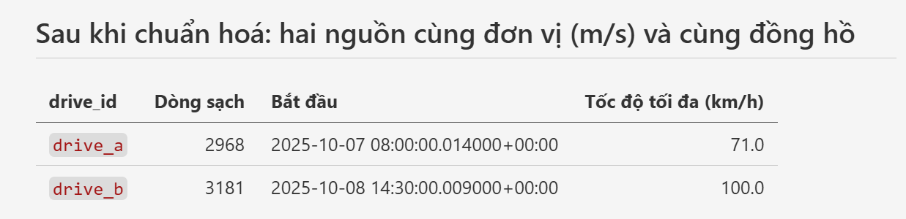
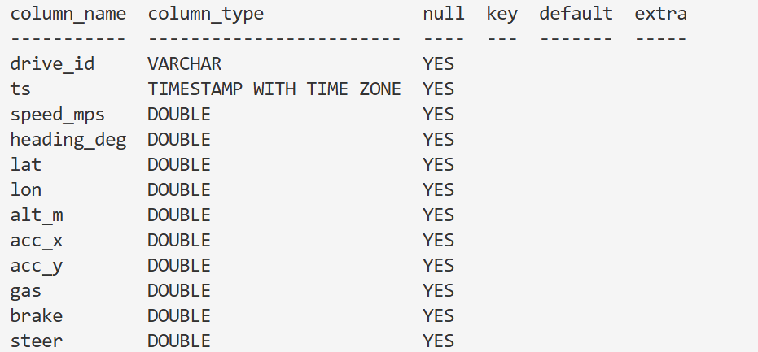
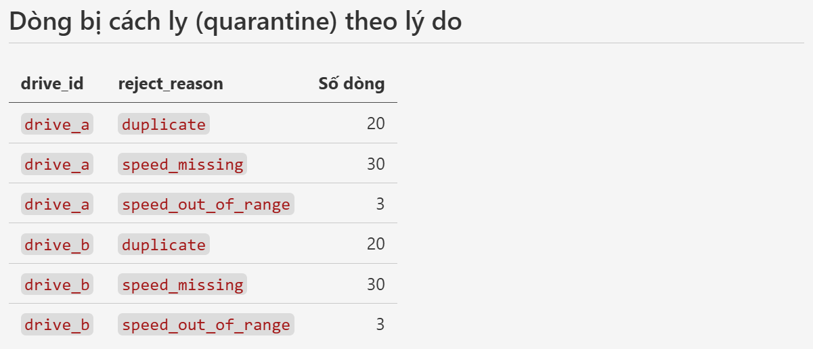

# REPORT — Lab Day 9

> Điền **bằng lời và số liệu của chính bạn** (lấy từ đầu ra của `scripts/lab.sh step ...` và từ `report/evidence/*.json`). Bài làm công khai trên GitHub; giảng viên đối chiếu với lịch sử commit và với bài của các bạn khác. Mỗi câu 3 đến 8 dòng là đủ.

| | |
|---|---|
| Họ và tên | `Bùi Việt Anh` |
| MSSV (đúng bằng `LAB_STUDENT_ID` trong `.env`) | `2A202602611` |
| GitHub | `VietAnh-AI2-UET` |
| Trip dùng cho bài tập sập và chạy lại (xem GUIDE, bước 5) | `trip-04324` |

***Riêng bước 5 dùng mssv = 02611, các bước trước đó dùng 2A202602611***

## Kết quả cuối

- `dataset_version` của bạn: `407a0a8953a0`  (phải khớp `report/evidence/run_summary.json`)
- Số khung hình train / val / test của bạn: `659/163/197`
- `report/verify.txt`: tạo bằng `python3 scripts/check_submission.py --save-verify` (phải có `27/27 checks passed`).
- Ảnh chụp trong `report/screenshots/`: `airflow_graph.png`, `minio_lake.png`, `metabase_dashboard.png`, và ảnh bài tập sập/chạy lại (log task đỏ thấy trip của bạn).

## Bước 1 · Bronze

### Câu 1
Liệt kê **ít nhất 4 khác biệt** giữa telemetry nguồn A và nguồn B mà bạn thấy ở bronze. Vì sao pipeline giữ **mỗi nguồn một bảng bronze** và để mọi cột ở dạng chữ, thay vì gộp và ép kiểu ngay?

**Khác biệt:**

- Khác số record: drive_a 3021 bản, drive_b 3234 bản
- Khác format timestamp: drive_a dùng utc, drive_b dùng ms
- Khác đơn vị đo vận tốc: drive_a dùng mps, b dùng kmh
- drive_a dùng gas, b dùng throttle_pct

**Lý do không ép kiểu ngay:**

- Vì không phải trường nào chứa số cũng là số
- Ép kiểu có thể làm mất thông tin
- Có những ô không có giá trị
- Bronze chỉ nên lưu giá trị thô, việc xử lý sẽ ở Silver

## Bước 2 · Silver telemetry

### Câu 2
Pipeline đưa hai nguồn về một schema như thế nào (đơn vị, kiểu thời gian, **độ lệch đồng hồ**)? Bằng chứng nào trong kết quả bước 2 cho thấy đã đúng? Dán bảng quarantine của bạn (số dòng theo từng lý do, từng drive) và giải thích vì sao dòng lỗi vào `rejects` thay vì bị xoá.

**Cách Pipeline đưa hai nguồn về một schema:**

- Chuẩn hóa:
    - Đơn vị: tốc độ B chia 3.6 để đổi km/h → m/s; ga/phanh B chia 100 để về khoảng 0–1 như A.
    - Thời gian: A từ chuỗi ngày giờ, B từ số mili giây; cả hai chuyển thành kiểu thời gian có múi giờ.
    - Độ lệch đồng hồ: B trừ telemetry_clock_offset_ms trước khi chuyển thời gian để khớp với video; A không cần điều chỉnh.

- Đưa về cùng 1 bảng `silver_telemetry`:
    - Nếu record đó hợp lệ
    - Phân định nguồn bằng `drive_id`

**Bằng chứng:**
- Độ lệch đồng hồ:
    
    - Thời gian bắt đầu camera trong data/sources.json: 2025-10-08T14:30:00+00:00
    - Pipeline đã trừ đi một lượng telemetry_clock_offset_ms = 1500

- Các trường khác được chuyển về cùng một đơn vị:
    

**Bảng quarantine:**
    

**Tại sao dòng lỗi vào reject chứ không phải xóa:**
- Để không làm mất dữ liệu, có thể kiểm tra nguyên nhân và xử lý lại khi sửa quy tắc. Đồng thời, bảng silver sạch chỉ giữ các dòng hợp lệ để phân tích.

### Câu 3
Vì sao test `max_gap_ms` là `warn` còn `in_range` là `error`? Kết quả thí nghiệm `break-gate` của bạn (`break_gate.json`): test nào bắt được, bao nhiêu dòng, và điều đó cho biết gì về vai trò của "cổng chất lượng"?

- `max_gap_ms` là khoảng cách giữa 2 lần đo cảm biến, khoảng cách hơi lớn thì có vẻ mất tín hiệu, nhưng chưa cần dừng pipeline. 

- `in_range` là `error` vì tốc độ ngoài khoảng 0–70 m/s là dữ liệu không hợp lệ.

- Test `in_range` bắt được 6 dòng khi nới luật lên 1000 m/s. Điều này cho thấy cổng chất lượng vẫn chặn lỗi khi bước làm sạch bị cấu hình sai. Sau khi khôi phục luật, không còn `ERROR`.

## Bước 3 · Silver frames

### Câu 4
Dựa vào `idempotency.json`: số dòng trước và sau hai lần chạy lại, và khi ghi kiểu `append`. Vì sao Delta `overwrite` theo partition (một trip) an toàn hơn xoá rồi ghi lại, nhất là khi giữa chừng có lỗi?

**Số dòng trước và sau 2 lần chạy:** 1246

**Số dòng trước khi append:** 60

**Số dòng sau khi append:** 120

**Lý do Delta overwrite:** Vì append thì sẽ duplicate

### Câu 5
Khung hình **đen** và khung hình **tối** khác nhau thế nào, pipeline xử lý khác nhau ra sao, bạn có đồng ý không? Dựa vào `threshold.json`: nếu chọn ngưỡng 0, 2, 6 thì bao nhiêu khung bị coi là trùng ở mỗi drive? Bạn chọn ngưỡng nào, vì sao, và ngưỡng đó phụ thuộc vào tốc độ xe thế nào?

| dHash khác tối đa | số khung trùng, drive A | số khung trùng, drive B |
|---|---|---|
| 0 | 61 | 8 |
| 2 | 149 | 53 |
| 6 | 363 | 244 |

- Khung đen là mất hình, khung tối là ánh sáng yếu (đi qua hầm, ban đêm, ...)

- Pipeline gắn cờ is_black = True cho khung đen, loại khỏi Gold, is_dark = True cho tối, có để giữ lại trong Gold

- Đồng ý

- Ngưỡng 0: drive A có 61 khung trùng, drive B có 8; ngưỡng 2: 149 và 53; ngưỡng 6: 363 và 244.

- Chọn ngưỡng 2 vì ngưỡng 0 dễ bỏ sót khung gần trùng, còn ngưỡng 6 dễ loại nhầm khung có cảnh khác nhau.

- Với cùng số khung lấy mỗi giây, xe chạy chậm thì cảnh ít thay đổi, dễ có khung trùng; xe chạy nhanh thì cảnh thay đổi nhiều hơn.

## Bước 4 · Gold

### Câu 6
Dựa vào `leakage.json`: chia theo khung hình làm bao nhiêu trip bị chia cắt, so với chia theo trip? Vì sao điều này làm điểm kiểm thử đẹp một cách giả tạo?

- **Chia theo khung hình:** cả 26/26 trip bị chia vào nhiều tập.
- **Chia theo trip:** 0 trip nào bị chia cắt; mỗi trip chỉ nằm trong một tập.
- **Điểm kiểm thử đẹp giả tạo:** chia theo khung hình kiến các khung trong cùng một trip có cả ở train và test, mô hình học trên tập train và gần như biết trước test, nên điểm cao, nhưng không có nghĩa là có khả năng dự đoán tốt trên trip mới trên thực tế.

### Câu 7
Vì sao `dataset_version` là **băm nội dung** chứ không phải ngày giờ hay số đếm? Hai lần chạy liên tiếp cho kết quả gì? Vì sao `dataset_version` của bạn **khác** bạn bè dù cùng dữ liệu (liên hệ MSSV)?

- `dataset_version` dùng **băm nội dung** để cùng nội dung thì có cùng mã, nội dung đổi thì mã đổi.
- Hai lần chạy liên tiếp cho ra kết quả giống nhau, vì nội dung giống nhau.
- Nếu dùng ngày giờ hoặc số đếm, mỗi lần chạy có thể tạo mã mới dù dataset không thay đổi, khiến khó nhận biết hai phiên bản có thực sự khác nhau hay không.
- **MSSV được dùng để chia dữ liệu** vào `train`, `val`, `test`. MSSV khác nhau khiến các trip được phân vào các tập khác nhau.
- Vì vậy, dù dữ liệu đầu vào giống nhau, dataset sau khi chia khác nhau nên `dataset_version` cũng khác nhau.

### Câu 8
Đọc phần `lineage` trong `manifest.json` của dataset bạn. Trả lời "dataset này được tạo từ dữ liệu nào?" bằng chính nội dung đó. Nếu một người hỏi 3 tháng sau, thông tin nào giúp tái tạo lại đúng dataset này?

- dataset được tạo từ:
  - `bronze.raw_telemetry_a`, `bronze.raw_telemetry_b`, `bronze.trips_raw`: phiên bản **0**.
  - `bronze.video_files`: phiên bản **1**.
  - `silver.frames`: phiên bản **27**.
  - `silver.telemetry`, `silver.frames_flagged`, `silver.frame_telemetry`: phiên bản **0**.
- **Để tái tạo sau 3 tháng:** cần giữ đúng các phiên bản bảng trên, video gốc có mã `input_video_sha256` khớp, cùng quy tắc lọc và chia dữ liệu, cùng MSSV **`2A202602611`**.
- **Để đối chiếu kết quả:** dùng `dataset_version` **`407a0a8953a0`** và `manifest_sha256`.

## Bước 5 · Điều phối và phục vụ

### Câu 9
Mô tả chính xác điều xảy ra khi trip của bạn sập rồi chạy lại: bao nhiêu task chuyển đỏ, bao nhiêu task `upstream_failed`, bạn clear gì, dữ liệu có nhân đôi không, `dataset_version` có đổi không? Bằng chứng (ảnh, số) là gì?

- 1 task đỏ: silver_frame[26]; 7 `upstream_failed`; clear task đỏ, dữ liệu không nhân đôi, `dataset_version` không đổi

- **Evidences:** Please find in report/screenshots

### Câu 10
Nâng từ 2 drive lên **500 xe mỗi ngày**: ba thành phần nào của pipeline này sẽ vỡ đầu tiên, và bạn thay bằng gì (nối với slide 12, 22, 23)?

- silver_frames, dbt_run_silver, export_dataset sẽ vỡ đầu tiên

**Thay thế:**

- silver_frames: Chia trip cho nhiều máy xử lý, giảm tải CPU
- dbt_run_silver: Thay DuckDB bằng Spark để chia việc cho nhiều máy; chỉ đưa thông tin khung hình vào bảng, không đưa video.
- export_dataset: saoDùng danh sách đường dẫn ảnh để tạo bộ train/val/test, hạn chế sao chép ảnh sang nơi khác.

## Câu hỏi riêng của bạn trên Metabase

Câu SQL bạn thêm vào dashboard và điều nó cho biết:

```SQL
SELECT
    drive_id,
    flagged_dark_kept AS dark_frames
FROM marts.mart_frame_funnel
WHERE flagged_dark_kept > 0;
```

- drive_a = 4; drive_b = 61

## Nhìn lại

Điều bạn thấy bất ngờ nhất, điều gì còn chưa rõ, và một lỗi dữ liệu mà bạn nghĩ pipeline **chưa** bắt được (nếu có). Tối đa 8 dòng.

- **Điều thấy bất ngờ nhất:** Không quá quen dùng Minio, Airflow, nên chưa biết bất ngờ gì, ấy pipeline xử lý khá ổn

- **điều gì còn chưa rõ:** Chưa hoàn toàn nắm được cách pipeline xử lý dữ liệu
